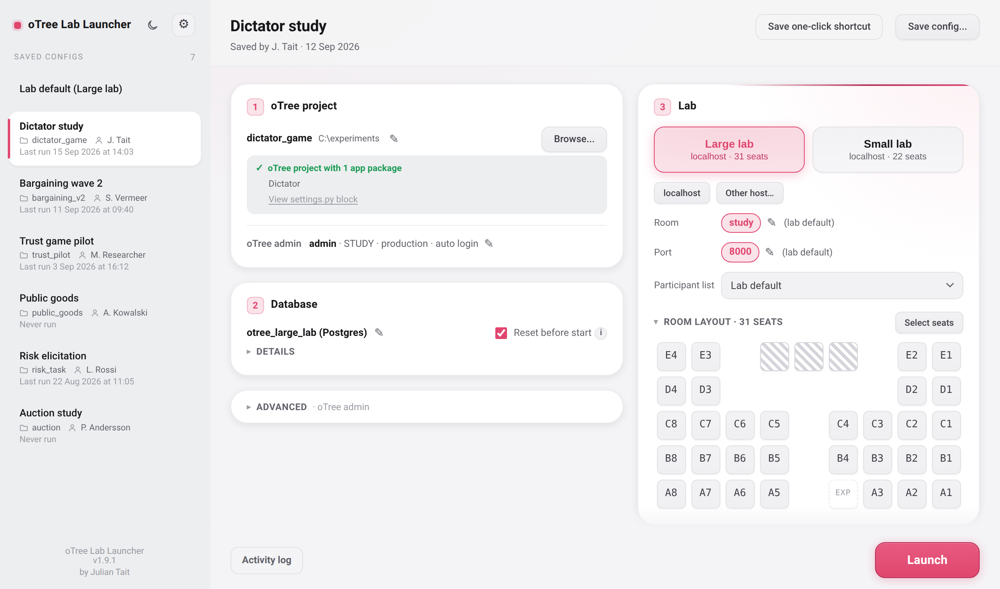
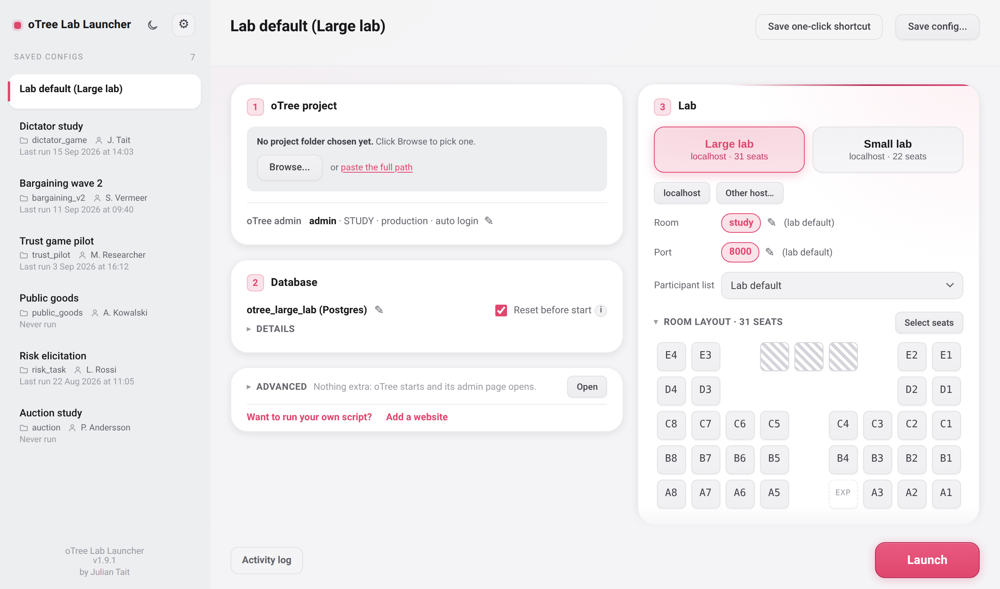
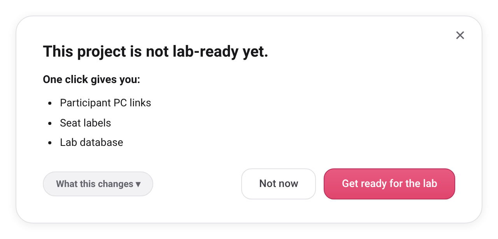
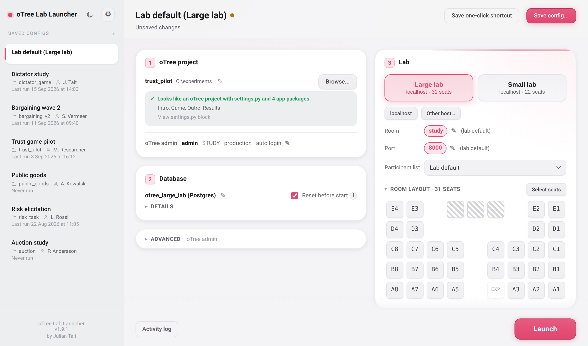
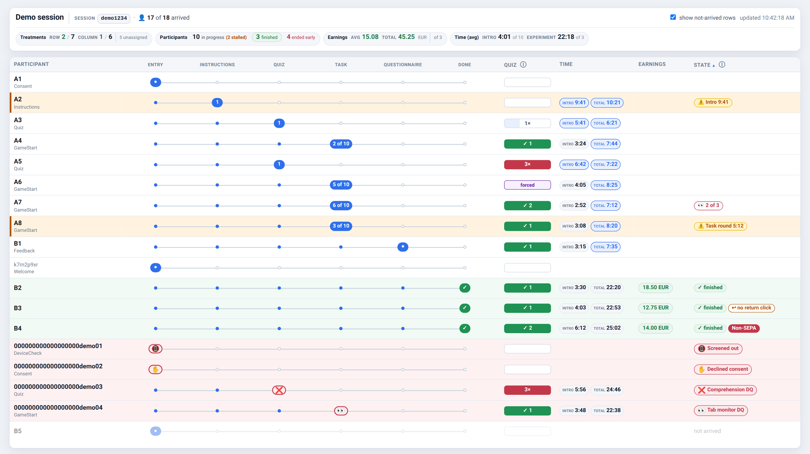

# oTree Lab Launcher: user guide

## 1. Introduction

The oTree Lab Launcher takes a working oTree experiment and makes it run in your
lab in a few clicks. You point it at your project folder and it wires up the
database, the per-seat participant links, and the experiment room, then starts
the oTree server ready for participants to sit down and begin.

It runs as a desktop app that opens in your default browser (there is also a
simple native-window version). Two people use it: a **lab manager** who sets the
machine up once, and **experimenters** who then launch their own studies without
touching any of that setup.

## 2. Usage

### Part 1 — Lab manager (one-time setup)

The lab manager looks after the machine that runs sessions. This is a one-time
job. Once it is done, experimenters never repeat any of it: they open the
launcher, point it at their project, and launch.

**Your settings: three files in `data/`.** Everything the launcher saves lives in
the `data/` folder next to the app, and nothing in it is part of the app, so an
update never touches it:

- **`lab_info.json` - the lab.** The labs (name, host address, default port, seat
  list, room map, default room, participant-shortcut label, a suggested database name),
  the room maps themselves, the default oTree admin login for new configs, and
  the lab-wide settings (the GitHub organisation, "Databases on this computer
  only"). **This is the one file you copy to every computer of the lab.** It
  holds no database passwords.
- **`machine.json` - this computer only.** Which lab this computer is, which
  labs it shows, the light/dark theme, the Postgres superuser login, and this
  computer's databases with their passwords (plus the folder GitHub studies were
  last saved into and, per GitHub token, who added it, when and its expiry
  date, never the token). Never copy it to another computer.
- **`saved_configs.json` - this computer's saved configs.** Each config points at
  one of this computer's databases by name (id) and keeps its own oTree admin
  login.

**The setup wizard (once per computer).** When a computer has no lab yet, the
launcher opens a **setup wizard** with three steps:

1. **Lab: which lab is this computer?** Pick it from the labs in
   `lab_info.json`. On the very first computer (no labs yet) you add the lab
   here instead: **a name, the host address of the machine that runs sessions,
   its default port and the seat list**, then **Next** (or **Use example values**).
   The port starts at 8000: leave it unless your lab needs another (see **The port**
   below); a value outside 1 to 65535 keeps you on this step. The default
   room, shortcut label, room map and default oTree admin login all have working
   defaults and sit under **More options**.
2. **Postgres on this computer.** The Postgres superuser (prefilled `postgres`)
   and its password, then **Next**. **Next tests the login**: if Postgres does
   not accept it, the wizard stays on this step and shows the reason, so a wrong
   password is caught here. **The password may be left blank** if this Postgres
   user has none (e.g. Postgres.app on a Mac, or a trust login). **No Postgres on
   this computer? Click Skip**: the wizard then finishes at once, because without
   a Postgres login no database can be created. Launches use oTree's own SQLite
   until you add a Postgres login in Settings.
3. **Databases.** The default database is pre-filled with the lab's suggested
   name; keep it or change it and click **Save**: the wizard creates it and saves
   this computer's setup. **It uses the Postgres login from step 2** (no separate
   database user or password to set); tick **Advanced** to give it a user of its
   own or to link a database that already exists. **+ Add another database**
   adds more. You may **Skip** this step too: the computer is then set up with
   no database.

**To set up the next computer of the same lab: copy only `lab_info.json` into
its `data/` folder and start the launcher.** The wizard asks which lab it is and
creates that computer's own databases (with the same suggested name).

Everything the wizard set is editable later under the **gear (Settings)**. Each
section there is one line (for example *Databases: otree_large_lab (default) +
2 more*) with an **Edit** button that opens it; the small **i** next to a title
or field explains it.
Room maps are part of `lab_info.json`; the two example maps ship in
`app/assets/maps/`, whose README explains the map format.

Each database is listed by its nickname. A database on another computer also
shows a grey **on HOST:PORT**; one on this computer (`localhost`) shows nothing
extra. In **Settings -> Databases**, the round button in front of a database
makes it this computer's **default** (the one the Lab default config uses), and
**Edit** / **Delete** sit on its row (Delete asks first and only removes it from
this computer's list, never from Postgres). Which computer a database was created
on, and when, is shown in its **Edit** dialog. A database on `localhost` only
exists on the computer it was made on: a database that shows **"Created on
<computer>, not this computer"** was made elsewhere, so `localhost` on this
computer is a different Postgres and a database of the same name here is not the
same data (the **i** next to the warning, and the Edit dialog, say this in
full).

**Upgrading from 1.4 or older.** The first start of 1.5.0 converts the old
settings files (`presets.json`, `lab.local`, `ui_prefs.json`, the old
`lab_info.json`, `maps/`) into the three files above, once, and shows a short
banner. The old files are moved to `data/retired/` (with a README.txt); they are
safe to delete once the launcher works, and copying them back is how you would
return to an older version.

**What depends on the setup: three tiers**

Which features are available to experimenters depends on how far the lab manager
takes the setup.

1. **SQLite — always works, zero setup.** oTree's built-in SQLite database needs
   no configuration at all. It is the option that always works out of the box,
   and the whole session runs on the local machine. Any experimenter can use it
   with nothing set up by the lab manager. In the app it is the
   **"No lab database (oTree SQLite)"** option. If you do nothing else, this
   still works.

2. **Postgres — for a shared or custom database.** To give this computer a
   default database that every experimenter gets in one click, and/or to let
   experimenters use their own Postgres databases, the lab manager must install
   PostgreSQL on the computer and enter the **Postgres superuser and password**
   in the setup wizard (or later in Settings). With that done, the wizard
   creates the default database, and the in-app buttons let anyone create their
   own database later, so you do not have to make one per study.
   (Creating a database from the app also needs `psycopg2`:
   `pip install psycopg2-binary`.)
   **Postgres passwords may be left blank.** Every Postgres password field (the
   superuser in the wizard and in Settings, a database's own user) can stay
   empty when that Postgres user has no password, as on Postgres.app on a Mac or
   with a trust login. The launcher then connects with no password at all, and
   the database address it gives oTree has no password part
   (`postgres://user@host:5432/name`).
   **A database's user is optional.** **Create a new database** asks only for
   a name and the researcher: the database is then owned by, and connects as,
   **this computer's Postgres admin login** (the one in Settings). The
   database remembers only *that* it uses the admin login, not a copy of it, so
   changing the admin login in Settings changes it for these databases too.
   If no admin login is stored, such a database cannot be used, and Settings
   and the launch check say so. Tick **Advanced** and **fill in User** to give
   the database its own role, with its own password; the same Advanced box holds
   the tick for registering a database that already exists. A blank password there only works if this
   Postgres lets users in without a password (e.g. Postgres.app); **on a
   standard Windows install, set one.** Right after creating or registering a
   database the launcher tries to log in with it; if Postgres refuses a user
   with no password, the database is kept and a warning tells you to **set a
   password (Edit database)**.
   **Databases stay on this computer by default.** Settings -> Databases
   has a lab setting, **"Databases on this computer only (localhost)"**, which is
   **on** for new and existing installs: every database Host is `localhost`, with
   no pen to change it. It is saved in `lab_info.json`, so it applies to the
   whole lab. (The databases themselves are per computer, in `machine.json`.)
   **To use a database on another computer, untick that box first.** It can then
   be added, but only registered, not created. In the add-database dialog the
   **Host** shows `localhost` greyed out; **click the pen at the end of the box**
   to type another IP or hostname (the Port unlocks with it). As soon as the host
   is not this computer, Advanced opens and **"The database already exists in
   Postgres"** is ticked and locked: the database must already exist there, and launches then connect
   to that host. Switching back to `localhost` brings the create option back.
   A database on another computer is always shown with its address in grey
   (e.g. *on 192.0.2.10:5432*) in the database picker, on the Database card and
   on the launch confirmation screen, so it is obvious the session uses another
   computer. That computer's firewall and Postgres (`listen_addresses`,
   `pg_hba.conf`) must allow the connection; test it with a plain `psql -h`
   first.

3. **GitHub — for getting experiment folders from your lab's GitHub
   organisation and keeping them up to date.** Optional and **off until an
   organisation name is typed**. The lab manager does three things, once:
   - **On GitHub:** create an organisation for the lab with base member
     permission **Read**, make the lab's own GitHub account a member, and allow
     fine-grained personal access tokens.
   - **In the launcher, on each lab PC: gear -> Settings -> GitHub -> Edit**, and
     **type the organisation name**. That is the whole setting (an empty field
     is off). It is a lab setting, saved in `data/lab_info.json`, so it travels
     with that file.
   - **Still in that section, click "Add token"**, pick who you are under
     **Added by**, optionally a **Name** that says what it is for, paste the lab account's read-only token (no GitHub username
     needed), and **Save**. **Create the token on GitHub** in that
     dialog opens GitHub's own form already filled in (the organisation,
     *Contents: Read-only*, the expiry): choose *All repositories*, generate,
     copy, paste. The launcher **asks GitHub once whether the token is right**:
     a wrong one is not saved (*"GitHub did not accept this token… Nothing was
     saved."*). **A computer can hold several tokens** (the lab token, plus a
     researcher's own for a private repository): Settings lists each as
     *Token, added <date> by <name>*, with **Delete** (it asks first, naming
     who added it and when). Getting a study uses the first token that can
     open it. **Never** use a personal account's token on a shared PC unless
     its owner deletes it again afterwards.

   **The full step-by-step setup is in
   [GitHub: setup and use](github_org_sync.md)** (organisation settings, the lab
   token, researchers' own computers, publishing a study into the organisation,
   moving repos between organisations, troubleshooting).
   **The launcher never keeps a token itself**: the login goes to the computer's
   own credential store (Windows Credential Manager, the macOS Keychain). The
   launcher remembers only who added each token, when, and its **expiry date**,
   and warns from 14 days before it (*"The GitHub token added 1 Oct 2026 by
   Julian expires on …"*). Git never asks for a login by itself, on Windows or on a Mac: the
   **GitHub login…** dialog is the one place for it, and it is offered wherever
   a login is what is missing.

   Once the organisation is set, experimenters get a **GitHub** button next to
   Browse. **What the experimenter sees**, always with the thing to do in bold
   and git's own output in a collapsed **Git output** block:

   - **Get a study.** Click **GitHub**, **pick the study from the list** (the
     organisation's repositories this computer's tokens can see) or type its
     name, **pick your name under Researcher** (required), and press **Enter**. The folder it is saved into is already filled in
     (always the launcher's git-ignored `local/` folder, each time the dialog
     opens); **Change…** picks another for that one study. On success the dialog
     closes and the new folder is selected, with *added by <your name>* after its
     name (hover it for the repository and date), and the Save dialog is
     prefilled with that name. If something is wrong the dialog **stays open**, says what to
     do in bold, and the button becomes **Retry**: *Check the name, or use
     another GitHub login* (GitHub answers the same way for a repository that
     does not exist and a private one this login cannot see); *Use that folder,
     or choose another folder* when the study is **already on this computer**
     (**Use that folder** selects it); *Add a GitHub login for this computer*.
     After a login is saved from here, the clone is retried by itself.
   - **Which studies are on this computer.** **Settings -> GitHub -> Studies
     from <org> on this computer** lists each study cloned here (and each fresh
     copy): repository, researcher, folder, date, with **Open folder** and **Use
     as study**. A folder that is gone is marked *folder no longer exists*. The
     log stays on this computer (`data/clone_history.jsonl`).
   - **Is this study up to date?** Every study folder that is a git repository
     is checked in the background when it is selected, and again when Launch is
     pressed if the last check is more than ten minutes old (**whether or not
     the GitHub organisation is set**; a `git fetch`, which only downloads what
     is new and **does not change the experiment files**). The project box then
     shows one of: **Experiment up to date · checked HH:MM**; the amber **A newer
     version of this study is available on GitHub.** with a **Git pull** button;
     ***settings.py* was changed on this computer and in the newer version.** with
     the choices below; **Could not check for a newer version: the login was
     not accepted.** with **GitHub login…**; or, when there is nothing to say
     (not a git repository, offline), nothing at all. It never blocks choosing a
     study or launching.
   - **Git pull.** The banner's **Git pull** button and the standing **Git
     pull** button do the same thing (only one of them is on screen at a
     time): they run `git pull` in the study folder and move the folder forward to the newest version. They never
     merge and never change files you edited on this computer.
     The result replaces the status line: **Nothing new: already up to date.**,
     or **Pulled N changed files.** with the latest commit and a collapsed
     **Changes pulled from Git** list, or **Git pull failed** with the reason
     and, right under it, the buttons that help.
   - **"Get ready for the lab" and updates.** The lab block is the launcher's
     own, so it never gets in the way. When `settings.py` also changed online and
     the block is the only difference from the committed file, the launcher backs
     the file up (a `.bak` in the study's `lablauncher_backups` folder), takes the block out, pulls, and puts the current block
     back: **Updated, lab support kept.** If the pull fails, the file is put back
     exactly as it was. A block you edited by hand, or any other edit in
     `settings.py`, counts as your own edit (next item).
   - **Your own edits in the way.** When a file was edited on this computer and
     also in the newer version, the launcher names the files and offers:
     **Show what's different** (changes nothing); **Get a fresh copy**, the
     recommended way; **Keep this version and launch**; and **Discard my edits to
     these files and update**, which asks first, naming the files, keeps a `.bak`
     of each file in the `lablauncher_backups` folder, and is refused while a session of this study is running.
   - **Its own commits.** When someone committed in this folder, the line says
     **This folder has its own commits, so sort it out with Git or get a fresh
     copy.** Get a fresh copy is the only button.
   - **Get a fresh copy.** Downloads the study again. The new copy takes the
     folder's name, so saved configs and shortcuts keep working. The old folder
     is renamed `RETIRED_<name>_<date>`. **The old folder remains as a backup**,
     and its gitignored and untracked files (for example a seat list) stayed in
     it: copy over what you still need. If the old folder had the lab block, the
     new one gets it too. It is refused while a session of this study is running.
     If something has the folder open (on Windows: a console or Explorer window in
     it), nothing changes and the message says what to close. A study in a
     sub-folder of its repository: the repository's top folder is what is renamed.

**The per-seat links (the important part)**

Each lab PC opens its own fixed link:

```
http://HOST:8000/room/study?participant_label=SEAT&welcome_page_ok=1
```

- `HOST` is the machine that runs the session (the one running the launcher).
- `8000` is the lab's port: 8000 unless you set another **Default port** for the
  lab (Settings, Labs, the lab's pen, next to the address).
- `study` is the room.
- `SEAT` is that computer's seat label.
- `welcome_page_ok=1` skips oTree 6's Welcome/Start page, so the seat auto-admits
  with no click.

**This exact URL (with `welcome_page_ok=1`) is the link to put in all lab
documentation and on the lab computers.** Without the flag, oTree 6 first shows a
Welcome page that needs a click. Set each machine's link once — as the browser
homepage or a bookmark, one seat per machine — and you never touch it again. The
link is always active; before the room session exists it shows a wait page that
advances on its own the moment the session opens. When a participant opens their
link, that seat flips from grey to green on the experimenter's monitor, which is
how the consistent links track who's who.

**Room warning.** The desktop shortcuts point at the `study` room. If a study
uses a different room, its links must point at that room instead:

```
http://HOST:8000/room/THEIRROOM?participant_label=SEAT&welcome_page_ok=1
```

The launch confirmation screen warns about this whenever the chosen room is not
`study`, and shows the correct link to use.

**The port.** Each lab has a **Default port** in Lab Settings, next to its address
(8000 when you set nothing). Participant computers must be able to reach it, so
check your lab's firewall: other ports than the default may need your IT department.
Exporting the participant-PC shortcuts uses the lab's default port. Shortcuts already
on the participant computers, and any script of your own that expects a port, keep
the old one, so export or change those after changing it. Ports below 1024 can need
administrator rights on some computers. The launcher does not ask for them: the
launch screen then says the computer does not allow that port, and Launch stays off.
oTree serves plain `http` on any port, also on 443, so links start with `http://`.

**Saving configs.** You can save a config per study. A saved config relaunches
that study in one click in later sessions, so common studies are always a
double-click away.

**Advanced: scripts, websites and values.** One card in Settings holds everything a lab
offers staff in **Advanced** on the main page. **Settings > Advanced: scripts, websites and
values > Edit**. It shows one lab at a time, this computer's lab first; the other labs are one
click away at the top.

- **Scripts** are commands that run on launch, each in its own terminal window. **Add script**:
  a name, the text to run (several lines are fine, for example `cd some/folder` and then
  `python server.py`), the **Default position** (before or after oTree, after when you set
  nothing) and what to do next (**Then**). **Try it** runs the saved text once, now.
- **Websites** are pages that open in a new browser tab on launch (for example the lab's FOG
  page). **Add website**: a name and a web address (`http://` or `https://` only; a program is
  a script).
- **Values** are what oTree and scripts are told: environment variables. Three are built in
  and cannot be deleted: **Computers to start** (the seats a script should start, chosen on the
  Lab card at each launch; scripts only), **Lab session number** (typed at each launch; oTree
  and scripts) and **Data folder** (`OTREE_DATA_FOLDER`, for the Download data button of the
  oTree template). **Add value** adds your own: a variable name, a name staff see, a starting
  value, a short description for its info tip, and **This is a folder** for a Browse button.

**Every row has one box, For staff:**

| Choice | What staff get |
|---|---|
| **Off** | They do not see it. A config that already uses a script, website or variable keeps it. A built-in value (Computers to start, Lab session number) is off in every config, also in one saved with it on. |
| **Available** | It is listed under **Ready to add** in Advanced. One click adds it. |
| **On by default** | It is in every launch unless staff take it out. |
| **Always on** | It is in every launch and staff cannot take it out. A lock shows on its row. |

- The box saves at once. Scripts and websites start as **Available**; the two launch values
  (Computers to start, Lab session number) are **Available** until you change them; Data folder
  starts **Off**.
- **Always on** keeps a thing in the launch. It does not stop staff typing today's lab session
  number or choosing today's seats.
- A value has one more tick in its Edit form, **Staff can change the value**. Off: the value you
  typed there is always used and staff see it but cannot change it. It then needs a value.
- **On by default** and **Always on** also apply to configs saved earlier and to one-click
  shortcuts. A shortcut whose lab switched on Computers to start or Lab session number asks for
  them in its small box, like any config that has them on.
- **Staff may add their own: scripts, websites, values**, at the bottom. Scripts and websites
  are allowed unless you clear the tick; values only when you tick it. Clearing a tick hides
  the Add button. What a config already has stays.
- Saved per lab in `lab_info.json`, so copy that file to the other computers of the lab as
  usual. This is a convenience for a shared lab, not a lock: anyone with `lab_info.json` can
  read and change it, and a launcher from before this change ignores the choices it does not know.

See **Launch timeline** in Part 2 for how scripts and websites run.

- Some names are refused: what the launcher sets itself (the `DB_*`, `OTREE_ADMIN_*` and `OTREE_LAB_*` names, for example) and what a launch depends on (`PATH`, `PYTHONPATH`, `HOME`, `TEMP` and similar). Names count as the same whatever their capitals, because Windows treats them that way.

The list is tidiness, not a lock: anyone with `lab_info.json` can read it.

**Updating the launcher.** When a new version exists, **a small dot appears on
the gear** (the launcher asks GitHub at most once a day). In Settings, at the
bottom, **Update** runs `git pull` on the launcher folder and then asks you to
**quit and reopen the launcher**; **Check for updates** asks again right now.
(A launcher that was downloaded rather than cloned shows a link to GitHub
instead of the button.) Your `data/` folder (labs, configs, databases) is never
touched: git ignores it as a whole. Before 1.5.0 a few
**shipped template files** lived in `data/` (`data/README.md`,
`data/lab_info.example.json`, `data/maps/README.md`, the example maps); the
1.5.0 update removes them from there. If a changed copy of one of them is in the
way (typically after copying a whole `data/` folder from another computer), the
update puts it back to the shipped version, retries, and says so: *"Restored 2
shipped template files that had been changed locally: ..."*. If any other file
has local changes, **the update stops and lists the files**, with a button
**Discard these changes and update**: after a confirm that names the files, the
launcher keeps a copy of them in `data/retired/`, puts them back as shipped and
updates. (Everything a lab owns is in `data/` and `local/`, which an update
never touches.) When copying lab settings between computers, copy only
`lab_info.json`.

### Part 2 — Experimenter (usage)

Three things, in order. Read the first line of each, do it, and move on. The
"if you want to change things" note is optional.

**(i) Add your experiment folder.** Two ways:

- Click **Browse** and pick your oTree project folder. The folder name then
  shows in bold with its parent folder beside it; hover it for the full path
  (with a Copy button in the web launcher). To type or paste a path instead,
  click the pen next to the folder name, or "paste the full path" in the empty
  state, then press Enter. The launcher always opens with no
  project chosen; to come back to a study in one click, save it as a config or
  as a one-click shortcut (below).
- Or click the **GitHub** button to get the folder from your lab's GitHub
  organisation. **Pick the study from the list (or type its name) and press
  Enter**; the dialog only closes once it has worked. If the study is already on
  this computer, click **Use that folder**.

*Note:* the GitHub button is only there if your lab manager has set the lab's
GitHub organisation in Settings. If it does not work, ask your lab manager.

#### Bring your study to the lab with GitHub

If your study lives in a GitHub repository, you do not need a USB stick.
(Details and screenshots of GitHub's side: [GitHub: setup and
use](github_org_sync.md).)

1. **Add your study to the lab's GitHub organisation** (`<your-org>`). Ask the
   lab manager to give you access first. Then create an empty repository there
   and push your study into it:
   [section 4 of the GitHub guide](github_org_sync.md#4-researcher-put-a-study-into-the-organisation).
2. **On the lab computer: click GitHub, pick `<your-study>` from the list (or
   type its name), choose your name under Researcher, press Clone.** The study
   is saved on that computer and selected at once.
3. **It stays up to date.** Each time the study is selected, the launcher
   checks GitHub. If there is a newer version, it says so: **click Git pull**.
4. **Optional, on your own computer: one push updates both copies.** In your
   study folder, after the first push of step 1:

   ```
   git remote set-url --add --push origin <your current URL>
   git remote set-url --add --push origin https://github.com/<your-org>/<your-study>.git
   ```

   **Run the first line too**: as soon as a push URL is added, git stops
   pushing to the original unless it is added back. `git remote -v` should show
   two `(push)` lines. From then on, every `git push` goes to your own copy AND
   the lab copy. `git pull` still comes from your own copy.

**(ii) Save or pick a config.** A config is your study's saved settings (folder,
lab, database, seats). Saving one with **Save config...** (top right)
writes it so you can relaunch that exact study in one click later — pick it from
the config list on the left instead of setting everything up again. Right next
to it, **Save one-click shortcut** saves a desktop shortcut for a saved config:
double-clicking it starts that config and opens the oTree monitor straight away,
without opening the launcher window. On a setup that is not saved yet it opens the Save
dialog first, then carries on to the shortcut. The header names the config on screen;
an amber dot after the name and "Unsaved changes" under it mean the screen
differs from what is saved, and the Save button turns pink. Each
config in the list on the left shows its folder, who saved it and when it was
last launched ("Never run" until then).

**Saving when you are ready.** The **Save config...** button at the top stays visible and always
reads the same. On a saved config with no edits it saves a copy under a new name. It works the
same as the save row in **Before you launch**, which appears only when something is unsaved:

- Nothing saved yet: **"This isn't saved yet. It will be saved as:"**, ticked, named after the
  study folder. A config needs a **researcher**: type one or pick one from the list. The button
  then reads **Save and launch**. Untick to launch without saving; it then reads **Launch**.
- A saved config with edits: **Save as new** with the next version ("Dictator study v2"), or
  **Replace <name>**, which runs these settings from its one-click shortcut too and sends the
  old version to Old configs. Untick to launch without saving: the shortcut and the next
  session keep the saved version, and the launch history says "<name> (changed)".
- Settings identical to another saved config: one line, "Same as <name>", and the launch runs
  as that config.

A failed save says why on the row and does not launch. If you switch config, delete, start a
new one, quit or close the window with unsaved changes, the launcher asks **Save / Discard /
Cancel** first. A launched study keeps running either way. In a plain browser tab a page cannot
show its own box, so closing the tab with unsaved changes gives only your browser's own "Leave
site?" question, without a Save choice; staying leaves everything as it was.

**Old configs and Config edits.** A deleted config is kept with its full contents, and so is
the old version when you Replace. Settings > **Old configs** lists them, newest first, marked
"deleted" or "replaced" with the date. Choose one to see what was in it (passwords are never
shown) and click **Recover**. It comes back in the list without changing what is on your screen.
If the name is taken it comes back as "<name>-RECOVERED", then "<name>-RECOVERED-2". The list
is never cleaned up automatically. **History** also has **Config edits**: each Replace, script
Edit, delete and recover, with the old and new value per field, passwords only as "changed".
It is a helpful record, not proof of who did it.

**Undo.** The notice after **Delete** or **Replace** has an **Undo** button for about 20 seconds. It puts the config back under its own name, or the previous version back; if the name was taken in the meantime it comes back as "<name>-RECOVERED" and the notice says so. After that the copy is still in Old configs.

**Failed launches in History.** A failed launch has its one-line reason under the row (in Tk, choose the row to read all of it).

**Quitting.** **Quit** is at the bottom of Settings (the gear), next to **Old configs** and
**History**, which opens the launch history. Quit only closes the launcher: a
study you already launched keeps running.

**The settings.py block.** Once a folder is chosen, **View settings.py block**
is the small link in the oTree project section, under the app names and above
the git lines. It shows the lab support block, to copy it or to add it to the
project.

**Remove lab support block.** Once `settings.py` has the block, a second link,
**Remove lab support block**, sits next to **View settings.py block** (in Tk under
it; the block viewer has the same button). It asks first, saves a `.bak` copy of
`settings.py` in the study's `lablauncher_backups` folder, and takes out the launcher's block only: anything else you changed in
`settings.py` stays, and no older backup is put back. To run the study in the lab
again, click **Get ready for the lab**.

**Running a study from another branch.** With **Allow experimenters to switch
branches** ticked in Settings > GitHub (a lab setting, off by default), the oTree
project section shows **Branch** with the branch the folder is on and **Check
branches**. Check branches asks GitHub what is new (it changes no file) and lists
every branch, the current one marked; **Switch** on another branch asks first, then
moves the folder to it and brings it up to date. The lab support block is taken out
before and added back after, so it never gets in the way. If the folder has any
other change of its own (an edited file, a new file the branch would overwrite, or
commits on that branch that are not on GitHub), nothing is switched and the message
names the files: sort them out in the folder with Git. If a step fails half-way, the
folder is put back as it was. Whatever the setting, a folder that is **not on its
usual branch** says so in amber, for example *On branch lab-2026-11-10, not
master.*, so remember to switch back after the session. **Git pull** always updates
the branch the folder is on.

**What the one-click shortcut checks first.** It has no window, so it only
stops for the things that matter:

- **oTree is not found**: it stops, names the Python it ran with and says how
  to install oTree for it, and touches nothing. When you save a shortcut, it
  **remembers which oTree the launcher would run** (and, on Windows, which
  Python the launcher runs on), so it uses that same oTree even when it is not
  on the PATH, for example oTree in a virtual environment. If that oTree is
  gone later, the shortcut uses the `otree` command on the PATH instead; if
  there is none either, the box names the oTree that went missing: **install
  oTree again, then save the shortcut again**. If the launcher finds no oTree
  at all when you save a shortcut, it still saves it but tells you so: the
  shortcut will not launch anything until oTree is installed.
- **A session is already running** (the port is in use): it stops, says so, and
  touches nothing.
- For a few other things it **asks, in one box: "Launch anyway?"** (on a Mac the
  buttons read *Launch anyway* / *Cancel*; on Windows *Yes* / *No*): **the
  database cannot be reached**, **the config's room is not the lab's default
  room** (the participant computers open the lab's room), and, when the study
  folder is a git folder, **"Could not check GitHub for updates"** with the
  reason (offline, too slow, the login was not accepted, the folder is not
  linked to a branch on GitHub). A folder that is not a git folder never gets
  that line. Several at once are listed in the same box. **Cancel** changes
  nothing.
- **A newer version of the study is on GitHub**: the box says *There have been
  updates to this study. Latest commit: a1b2c3d, today at 14:32.* (an earlier day
  shows the date only, *3 Nov 2026*; if the commit cannot be read, only the first
  sentence), and has a third choice, **Git pull**. On a Mac the buttons read *Git pull* / *Launch anyway* /
  *Cancel*; on Windows they read *Yes* / *No* / *Cancel* and the text says what
  each does (**Yes = Git pull, then launch**, No = launch the version on this
  computer, Cancel = do nothing). Git pull downloads the newer version the same
  way as the launcher's Git pull button (it only moves the folder forward and
  never touches your own edits), then the shortcut starts again from the top,
  so every check runs again on the new version, and launches. If the pull does
  not work (for example a file was changed on this computer and online), the
  folder stays as it was and a box says why and asks "Launch anyway?".
- **A newer version is on GitHub, but this folder has its own changes** (a file
  changed here that also changed online, or commits made on this computer): it
  cannot be updated automatically, so the box only offers *Launch anyway* /
  *Cancel* and says so. **Sort it out yourself** (for example with git, or with
  **Get a fresh copy** in the launcher), then run the shortcut again. Changes of
  your own with nothing newer online never get a box.
- Everything else is silent.

**When the shortcut cannot start.** Every failure box says **why, in plain
words** (the exit code and the log file are only a small "Details" line at the
end). The shortcut runs a config **by its name**, so if that config was
**renamed or deleted** the box says "No saved config named ..." and lists the
configs that are saved on this computer. If that name is in Old configs, the box says
so and that it can be recovered there in the launcher's Settings; recovered under its own
name the shortcut works again. A config that came back as "<name>-RECOVERED" has a
different name, so the old shortcut does not run it: make a new shortcut. Its buttons: **Open the launcher**
(pick a config, or save one again under the old name, and click **Save
one-click shortcut** to make a new shortcut), **Delete this shortcut** and
**Close**. On Windows the buttons read *Yes* / *No* / *Cancel* and the text
says which is which. Shortcuts saved before version 1.7.0 do not offer
*Delete this shortcut*; save them again to get it. Other failures (the project
folder is gone, resetting the database failed, the server did not start or
never answered) name the problem the same way; a failed database reset quotes
the last lines oTree printed.

**A config saved with the lab's default room follows the lab.** If the lab later
changes its default room, such a config simply uses the new one (in the window
and from the shortcut) and never warns about the room. A config saved with a
room of its own keeps it.

*If you want to change things:* adjust the fields (lab, database, seats) before
saving. Saved configs are never edited in place — change a field and use **Save
as new config...** again to keep the original safe.

**(iii) Run it.** Once your config is saved or selected, click **Launch**
(bottom-right). A **"Before you launch"** screen appears with a summary and any
issues. When everything is clear it shows **Ready to launch**; click **Launch**
again to start. The server starts, the screen changes to **Session running**,
and the oTree dashboard opens on its own (**Open dashboard** opens it again).
The **i** next to the lab name shows the server, the room and the per-seat link.

*If you want to change things:* if the screen lists warnings (for example a
database that cannot be reached, or no participant file chosen), the button
reads **Launch anyway**; if it lists must-fix items, fix them first and the
button re-enables.

*If a newer version of the study is available:* when the automatic check (see
the GitHub section above) found one, the screen adds the amber reminder **"A
newer version of this study is available on GitHub. Git pull before launch."**
with a **Git pull** button. It warns and never blocks: pull there, or launch as
it is.

*What opens in your browser:* the screen lists it under **Browser pages that
will open** (**Pages sent to the browser** once it runs). Hover a name for its address; the
copy icon copies it and the eye icon writes it out. Each page on the timeline opens in its own tab, at its
place in the order. To change that for your study, open **Advanced** (under Database).

*What will launch* and *Session running* are in groups, each with a heading: **Where** (the lab,
its port and room, and what to open on the participant computers), **Values for this launch**,
what runs in order, the browser pages, and **Environment variables set** (a tick and the name;
**Show values** shows them, secrets masked). A script's text is behind **Show script**. On
Session running the result comes first, then **What happened**, row by row.

*Advanced.* The **Advanced** card under Database does not open in place. It names what this
launch does besides starting oTree:

- **On launch**: the steps in run order, for example *Wake lab PCs > oTree server > oTree
  admin page > FOG*.
- **Asks you for**: what you fill in at each launch (Computers to start, Lab session number).
- **Sets**: the values saved in this config.
- With nothing extra it says so in one line.
- Two questions are always there: **Want to run your own script?** and **Add a website**. Each
  opens Advanced with that form ready.

**Change** (or **Open**) opens Advanced as a window over the page: the **Launch timeline** on
the left, **Add your own** on the right. **Done** closes it. If a form has something typed in
it, Advanced asks first: **Keep editing** goes back to the form, **Discard** clears it and
closes. It always opens again on its start view.

*Launch timeline.* The launch itself, top to bottom: your scripts, **Reset database** when it
is ticked (always directly before oTree, and it moves with it; its tick stays on the Database
card), **Launch oTree server**, then the browser pages.

- **In the timeline means on.** There are no tick boxes. The **x** at the end of a row takes it
  out of this launch. It is not deleted: it goes to **Ready to add** on the right, and **Add**
  there puts it back.
- **The arrows are always there.** Reset database and Launch oTree server are one block with
  one pair of arrows, because they move together.
- **Show** opens a row: a script's text (it stops at about six lines and scrolls inside itself),
  or a website's address with **Copy link** and **Open**. **Edit** is there for your own script.
- A row says where it comes from: *From the lab* or *Yours*. A lab row you changed has **Use
  lab default** behind Show, to follow the lab again.
- **A lock instead of the x** means the lab keeps that step in every launch (*always on in this
  lab*). Your lab manager changes that in Settings.
- **A website opens where you place it.** Before oTree it simply opens, with no server yet. After
  oTree it opens when the server is ready. If a script fails, the launch stops and nothing after it
  opens: a website placed before that script is already open, and the report says "sent to the
  browser" for it. The launcher hands the address to the browser; it does not check that the page
  loads.
- **The oTree admin page stays after Launch oTree server**, because it cannot open before the
  server exists; its arrow says so when it stops there. By default it comes after every script, so
  with a failed script it does not load. A config that was never reordered opens everything as
  before.
- **Edit** on your own script changes its name, text, wait rule and port. On a saved config
  the edit is saved to the config straight away, with no Save and no new config; it keeps its
  place, and any other unsaved change on the form stays unsaved. On the Lab default or
  a config not saved yet there is nothing to write to, so it stays on the form until you save.
  Adding, taking out and moving stay on the form as usual. Lab scripts are edited in Settings.

*Values for this launch*, under the timeline, lists the values in use: see **Values** below.

*Add your own.* Up to three buttons, **Script**, **Website** and **Value**. Each opens a short
form that first says what the thing is and does.

- **Script**: a name, what to run, **When** (before or after oTree starts) and **Then** (carry
  on, wait until it has finished, or wait until a port answers). **Add to timeline** puts it
  where When says. **What a script can read** lists the variables a script gets.
- **Website**: a name and an address. It goes last; move it with the arrows.
- **Value**: a name and a value that oTree and your scripts can read (an environment variable),
  for this config only. See **Values** below.
- A problem keeps the form open with what you typed. Cancel closes and clears.
- If your lab does not allow own scripts, websites or values, that button is not there and a
  line under the buttons says so, for example "This lab does not let you add your own values".
  Your lab manager decides that in Settings.

*Ready to add* is one list of everything that is not in this launch: what the lab offers, and
your own things you took out. Each row says what it is in one grey line. **Add** puts it in.
Your own things have **Delete** there.

These choices are part of the config: save it to keep them.

*How a script runs.* In its own window, started minimised on Windows, titled
`oTree script: <name>`. It starts in the project folder, with your normal environment plus
`OTREE_LAB_PORT`, `OTREE_LAB_ROOM` and `OTREE_LAB_PROJECT` (and the values in use, see **Values** below). It never gets `DATABASE_URL` or
the admin password. Text runs as a batch file on Windows and with `sh` on Mac and Linux.
The launcher writes these files to a temporary folder, never into your project. The window
closes when the script ends with exit code 0, and stays open on any other code so you can
read the error. On a Mac, whether a finished window disappears is your Terminal profile's
choice ("When the shell exits"), the same as the server's window.

**Then** sets when the launch moves on:

- **Carry on**: start it, watch it for 3 seconds, go on. A script still running by then is
  only known to have started.
- **Wait until finished**: wait for it to end (up to 5 minutes).
- **Wait until a port answers**: wait for a web request to that port to get an answer (up to
  1 minute). If the port already answers, the script is not started, so a second launch
  does not start it twice. Use this rule to say what a script should achieve.

*If a script fails, the launch stops.* Any non-zero exit, a port that never answers, or a
wait that runs out stops everything, also after oTree has started: no later script runs, and
**no browser page opens, the admin page included**, on purpose, so nobody carries on with a
broken setup. The launch counts as failed. Anything already started stays running: if oTree
started, close its window before launching again, because a new launch is refused while it
runs. One-click shortcuts do exactly the same and show the same text in their error box.

*The summary box says what the launcher checked.* After a launch with at least one script,
each row has a mark (with no script, the box lists the pages sent to the browser as before):

- **✓** was checked: *finished, exit code 0*, *port 9000 answering*, *answering on port 8000*.
- **○** is all that could be known: *started, still running after 3 s, not checked further*,
  *skipped: port 9000 already answered*, *sent to the browser*.
- **✗** failed, with the exit code, the rule that failed, how long it ran, the script's text
  and the title of its window. The launcher does not capture a script's output: **look in
  that window**, which stays open.
- **–** *not run because an earlier step failed*.

*What the launcher cannot see.*

- A script that ends with exit code 0 although something went wrong counts as finished. Mac and
  Linux run your text with `sh -e`, so a failed command, such as a `cd`, stops it (add `|| true`
  to a command that may fail). **Windows batch files have no such mode, and the launcher does
  not rewrite your lines: there only the last command's exit code counts.** A failed `cd` in the
  middle goes unnoticed unless you write `cd /d folder || exit /b 1`.
- A crash after the launch was confirmed is not tracked. Nothing watches a script after that.

*The port:* the summary always names it (**Port: 8000**). In the Lab card, the
**Port** pill shows the port this launch will really use, and why: *(lab default)*,
*(default)* off a lab, or *(this config)*. Click the pen next to it to type a
port for this config (1 to 65535), or **Use the default** to go back. Save the config to
keep it; a one-click shortcut launches the saved config, so it keeps the port too.
Choosing another lab or host applies that lab's default and drops the port you
typed, and the pill shows the result. A config that never chose a port follows its
lab, also when the lab's default changes later. On a port that is not the lab's
default, the summary gives the link to open instead of the lab's shortcut.

*The server window:* it stays open when the server stops, so you can read an error,
and after Ctrl+C you can start the server again from that window with the same settings
(`otree prodserver` plus the port). Use that window for it: a new terminal does not
have the launcher's settings, and without `DATABASE_URL` oTree falls back to SQLite
without saying so.

*Ending a session from your study:* any study may stop its own server cleanly by
exiting with exit code **42**, for example an End session button calling
`os._exit(42)`. The launcher's server window then closes, on that code only. On a Mac,
Terminal decides whether a finished window disappears (Settings, Profiles, Shell,
"When the shell exits"); by default it stays, saying the process completed.

*If a session is already running:* the screen shows the must-fix **"Port 8000 is
in use: a session or another program is already running on it."** and **Launch stays
off**. Stop it first (close its server window), then click **Re-check**.
The launcher never resets the database of a session that is still running.

*Participant link check:* once the server is up, the launcher checks the lab you
selected: is the address your lab settings give for it this PC, and does the
server answer on it? The status list then shows **Participant link works**, or a
cross with what went wrong: **Selected lab is not this PC** or **Server not
answering** (or, for an unusable address, **Address only works on this PC**, **No
server address** or **Address name not found**). Hover over that line to see the
details and what to try. The usual cause is a lab PC whose address changed: in
Settings > Labs, change that lab's "IP address or host". If this PC is a different
lab, select that lab instead. The server keeps running either way. A one-click shortcut stays silent when the link works and shows a box
when it does not. The check runs from this computer, so it cannot see a firewall
that blocks other PCs: if they still cannot join, allow the port through the
firewall. If the address is already wrong before you launch, the "Before you
launch" screen warns about it too.

*If the launch fails:* the screen says **Launch failed.** at the top, with a
**See activity log** button right next to it. **Click it** to open the launcher's activity log
(the running record of what the launcher did, at the bottom of the window in the
classic app and behind the **Activity log** button in the web app): it opens
scrolled to the latest lines and briefly highlighted, so the error that stopped
the launch is right there. The same button appears wherever a message says to
see the activity log.

---

#### Values: computers to start, lab session number and variables

A **value** is something oTree and your scripts are told when you launch. Each has a name you
read and a variable name under it. The values in use are listed in **Advanced**, under the
timeline; the ones you can add are under **Ready to add**. Your lab manager decides which are
offered, which are on from the start, and which are always on (a lock).

There are two kinds:

- **Asked at each launch**: Computers to start and Lab session number. What you give is for
  this launch only: it starts empty, is never saved in the config, and does not count as a
  change to the config. **History** keeps it. Switching lab or config clears the seats.
- **Typed once and saved with the config**: every other value, in its box in Advanced.

**Computers to start** is for scripts that start computers, for example through an API. You choose the seats on the **Lab card**, under **Room layout**:

- **Select seats** turns it on for this config and opens the box and the map, in one click. Press it again to turn it off. It is on the Lab card whenever the lab offers it (Available, On by default or Always on), whatever the participant list is. With no participant list on the map, the button shows on its own and the map comes with it once you press it. Where the lab set it to Off, the button is not there and nothing is sent, also for a config saved with it on; where the lab has it always on, it stays pressed.
- Type a number. That many seats are selected on the map, from the top of the lab's seat list, in the order written in the list.
- Click seats to swap them. The number follows.
- **Before you launch** reads it back, *Computers to start: 5 (A31, A30, A29, A28, A27)*, beside the participant list, with **Change** to go back to the Lab card. What you typed as lab session number is kept when you do.
- With **Participant list** on **Edit for this run**, clicks on that same map take a seat out of the room. A small switch then shows above the map, **Clicks choose: Computers to start | Participant list**, on Computers to start at first. The line under the map says what a click does. One never changes the other.
- A seat out of the participant list is struck through and can still be picked.
- A number above the lab's seat count becomes the seat count, and a short note says so.
- Blank means 0 seats: no computers are started, and the launch still goes ahead.
- A lab with no seat list: the number still goes to your script, and a note says the lab has no seat list.
- **It does not touch the oTree room.** The room's seat list, the participant list and its exclusions stay as they are.

Scripts get `LAB_SEATS` (comma separated, like `A1,A2,A5`) and `LAB_SEAT_COUNT`. The oTree server does not get them.

**Lab session number** adds a box at the top of **Before you launch**, empty each time. It is a short text: letters, digits, spaces, hyphens, underscores and dots, at most 40 characters (`217`, `217b`, `test`). Blank is fine, and then the variable is not set. The oTree server and scripts get it as `OTREE_LAB_SESSION`.

The launcher does not check whether your study reads it. To read it in oTree, add this to `SESSION_CONFIG_DEFAULTS` in `settings.py` (with `import os` at the top):

```python
lab_session=os.environ.get('OTREE_LAB_SESSION', '')
```

Read it with `player.session.config.get('lab_session')`. It appears in the wide export as `session.config.lab_session` for each participant. If it is not set, nothing breaks: the value is empty.

The value is fixed when the server starts, so a second session in the same launch gets the same value. A new value needs a relaunch. On oTree's Create session page it shows as a box under Configure session, filled in with this value. A change there goes into that session only; History keeps what was typed at launch.

**For script writers.** **What a script can read**, in the script form and behind Show on a script's row in Advanced, lists all of them.

- Values arrive as environment variables and are never pasted into your script's text. On a Mac or Linux keep them in quotes: `"$LAB_SEATS"`.
- A value that is not in use provides nothing and removes any old value of that name from the environment, with no warning, even when your script mentions it.
- Windows has no empty variables: with no seats selected `LAB_SEATS` is not defined there, and `%LAB_SEATS%` in a batch file stays as that literal text. Check `LAB_SEAT_COUNT` first. A blank lab session number is not set on any computer.

**The one-click shortcut** has no launch screen. If Computers to start or Lab session number is in use for that config (because the config has it, or because the lab has it on), it asks in a small box first, only for those. The number of seats takes the first seats of the list. Cancel means no launch. Leaving the boxes blank is fine. With neither in use the shortcut does not ask anything. If the box cannot be shown at all (no Tk on this computer's Python and no other way to ask), the shortcut says so and starts nothing: take the value out in Advanced, or launch from the launcher window. On a Mac without Tk the shortcut asks with one native question per value instead.

**Variables.** Only when your lab manager has made one available: it shows under **Ready to add** in **Advanced**, by the name the lab gave it. Most people never see this.

- **Add** puts it under **Values for this launch**. Type a value in its box. For a folder, **Browse...** opens a folder picker; typing a path works too, and in a browser-only launcher it may be the only way.
- **Only a value with something in its box is set.** One with an empty box is not set, and nothing breaks.
- **It goes to the oTree server and to your scripts**, under its variable name, never pasted into a script's text. It is saved with the config like any other edit.
- **A value the lab has on from the start** comes with the lab's value. Type your own to change it for this config, or take it out with the **x**. *Set by the lab* means the lab fixed the value: you see it and cannot change it.
- **A value that is not in use stays as it was**: if this computer already sets that variable, the launcher leaves that alone for the server. Scripts do not inherit `OTREE_*` names, as always.
- **Value**, the third button under **Add your own** beside Script and Website, adds a name and value for this config only. A lab manager turns it on per lab with **Staff may add their own: values** in Settings; on localhost and Other host it is always there. With it off, the button is not there and a line under the buttons says the lab does not let you add your own values; a config that already has its own variable keeps it and can still change or remove it.
- **Before you launch** lists what will be set, by name; **Show values** shows the values. A name that looks secret (holding PASSWORD, PASS, PWD, TOKEN, SECRET, KEY or CREDENTIAL) has its value hidden there, in the activity log and in History; History then keeps only the name. It is still stored in plain text in `data/saved_configs.json`, as passwords are.
- **A folder that does not exist** gets a warning before you launch, not a block.
- **To read one in oTree**, with `import os` at the top of the file: `os.environ.get('OTREE_DATA_FOLDER', '')`. The value is fixed when the server starts, so a change needs a relaunch. The launcher says it set the variable; it does not check whether your study reads it.
- **`OTREE_DATA_FOLDER`** is for the Download data button on the experimenter dashboard of the oTree template, if your study has one. It saves up to three files, for all sessions in the database, in `SENSITIVE`, `ANONYMOUS` and `PAYMENTS` subfolders of that folder: SENSITIVE always, ANONYMOUS only if there is something to remove, PAYMENTS with as many columns as exist. It never overwrites a file: if a name is taken, the whole set moves to the next number. With no folder set, that button gives one browser download per file, with visible links. The folder must exist on the computer running oTree: a missing one is an error that names it, never created. Keep it outside your study folder: bank details in a study folder can end up in git. The running server reads the variable.

A one-click shortcut uses what the config saved and asks nothing. If a config holds a name the launcher refuses (hand-edited, for example), the launch stops and names it.

## Screens

### The main window



*Configs on the left; add your project and pick lab / database / seats on the right; Launch at the bottom-right. Things that are set once (the oTree admin login, the database, everything in Settings) show as one line with a pen or an Edit button.*

### The default run path, step by step

On the default path you do not set up the lab, database, or seats yourself:
**Launch** uses the lab default setup your lab manager already configured on the
machine, so you just add your project and launch.

**Step 1 — add your experiment folder (Browse).**



*Click Browse and pick your oTree project folder (or paste its path, or use the GitHub button).*

**Step 2 — make it lab-ready (if prompted).**



*If the project is not yet lab-ready, this popup appears. Click **Get ready for the lab** and the launcher wires it up for you.*

**Step 3 — launch.**



*Once the project is recognised and ready, just click **Launch**. The server starts and the oTree dashboard opens on its own.*

Studies built on the [oTree-Template](https://github.com/juliantait/Template_oTree) also have their own live monitor, at `/experimenter_dashboard` on the same server. Other studies do not have it, and the launcher does not add it:



*The oTree-Template's monitor, in a demo session with invented participants. One row per participant shows their progress through the study, quiz result, time, earnings and state: green has finished, red ended early, amber has stalled.*
